

# SuperDummy

**0.2.3 — Forge Edition**

*Build from a 3D reference, reuse entire sections and check structural support.*

<table>
  <tr>
    <td width="50%" align="center"><strong>Build in SuperDummy</strong></td>
    <td width="50%" align="center"><strong>See it in 7 Days to Die</strong></td>
  </tr>
  <tr>
    <td width="50%"><a href="assets/screenshots/0.2.0/superdummy-0.2.0-road-exit.png">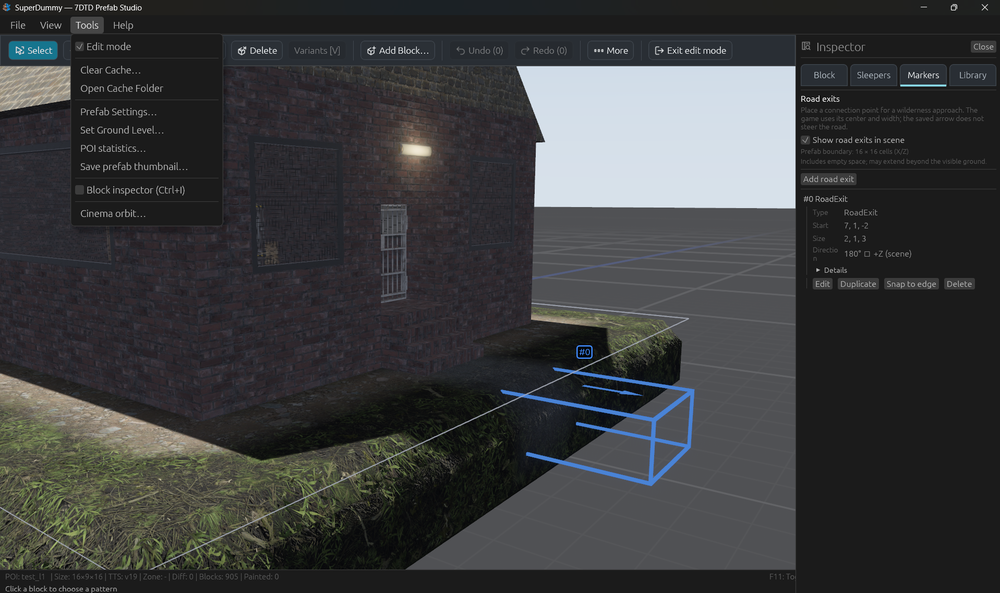</a></td>
    <td width="50%"><a href="assets/screenshots/0.2.0/superdummy-0.2.0-in-game.png">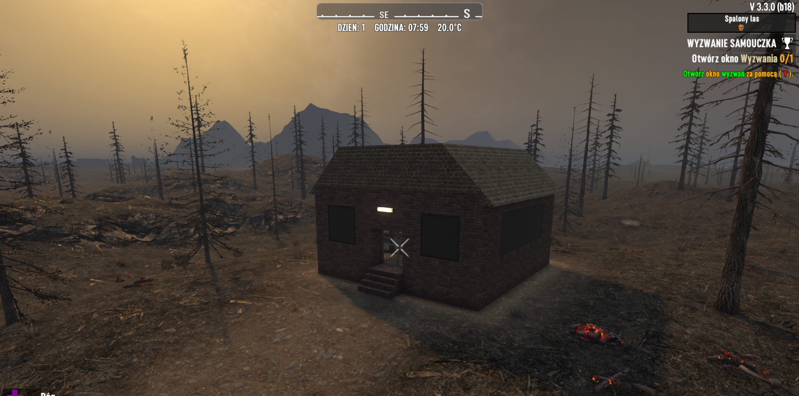</a></td>
  </tr>
</table>

*A small example prefab in the editor and in a generated game world. Click either image for the full-size view.*

**Build, explore and edit your own locations for 7 Days to Die.**

A prefab, also called a POI, is a building or place the game can put in its world. SuperDummy lets you work on one without opening a game world — no coding or Unity installation needed.

[What's new](#whats-new-in-023) · [First steps](#start-in-a-few-minutes) · [What can I make?](#what-you-can-do) · [Roadmap](ROADMAP.md) · [Report an issue](https://github.com/xvgray/superdummy-releases/issues) · [Support development](https://buymeacoffee.com/bullrider)

**Windows 10/11, 64-bit · Requires your own 7 Days to Die installation · No game assets included**

> [!IMPORTANT]
> **Please save your work often.** This version is still in development and may contain bugs. There is **no emergency autosave or recovery after a crash**. Unsaved work can be lost if the program closes unexpectedly. Use **Ctrl+S** regularly and **Save Prefab As…** to keep separate copies before major changes.

## What's new in 0.2.3

- **Build around a 3D model.** Open **Inspector > References**, add a GLB and set its size, rotation and opacity. Switch to **Solid** to see its shape, then hide the model to inspect your blockwork. SuperDummy saves the reference settings in a `.superdummy.json` file beside the prefab. If a model moves, use **Locate model...** to reconnect it. The game export contains the blockwork.
- **Reuse walls, rooms and floors.** Drag in **Select** to mark a group, then copy, move, turn, tilt or delete it. Paste the same section repeatedly to build a row of windows or stack floors. Each placement is one Undo step.
- **Check structural support as you build.** Turn on **View > Structural stability** for a colour map of the prefab and terrain. Placement warnings call out possible support problems. The result is an estimate under the editor's ground assumptions.
- **Set how damaged a block starts.** Enter its remaining HP in the Inspector. Supported models, such as certain doors, show the corresponding damage state.

[Release notes](RELEASE_NOTES.md) · [Full changelog](CHANGELOG.md) · [Development roadmap](ROADMAP.md)

## What you can do

- **Start a new building** with an empty workspace or flat ground, or open an existing prefab as a local copy.
- **Build and change individual objects** — place, move, copy, turn and remove them, with a preview and Undo/Redo.
- **Paint your build** — use the game's textures on a face, a whole block or a flat area; fill connected surfaces, pick a texture and erase paint.
- **Make wall art from a picture** — Mosaic turns a PNG or JPEG into the game's existing paints, with colour/grayscale and detail choices. No custom-texture mod is needed.
- **Measure and align** — drag a ruler, place a laser level and show construction guide planes with metre scales in perspective or orthographic views.
- **Find your favourite parts quickly** in the block Library, choose variants and pin frequently used blocks to Quick Blocks.
- **Set up supported doors and lights** — choose Open/Closed, Locked/Unlocked or On/Off, and edit supported writable signs.
- **Prepare your POI for the game** — choose its world locations, set the ground level, add road-connection markers and edit the supplied basic enemy-spawn areas.
- **Explore and show your work** — fly around, inspect interiors, read statistics, save thumbnails and use the cinematic orbit camera.

SuperDummy reads blocks, models and textures from your own game installation. It does not modify the installed game files or include game assets in its download.

## Current editing limits

- **Painting uses supported surfaces and the base game's palette.** Imported pictures become mosaics of existing paints, not new textures. Mosaic currently needs a solid rectangular vertical wall; area and fill tools work on supported flat surfaces.
- **Mod-added blocks are not loaded.** SuperDummy reads the base game's block definitions and assets, not blocks or assets supplied by mods. A prefab that needs them may have missing parts.
- **Some game mechanisms are not supported yet**, including gas valves. Seeing an object's model does not mean its special behaviour can be configured or tried out in the editor.
- **Reference import uses GLB with embedded geometry.** Supported PNG/JPEG textures can be embedded or stored beside the model. Some large files can be imported without textures when their geometry fits the limits.
- **Very large prefabs may have problems loading or being edited.** They can take a long time to open, use a lot of memory or become slow to work with. Save often and keep separate copies of important projects.

Water editing and emergency autosave/crash recovery are also unavailable, as noted above. Version 0.2 may still contain bugs; please keep that in mind when working on a large or important build.

## Start in a few minutes

1. Download **[the latest Windows x64 release](https://github.com/xvgray/superdummy-releases/releases/latest)** and extract the **entire ZIP**.
2. Keep the **assets** and **resources** folders beside **superdummy.exe**. There is no installer, and you do not need to install Rust or Bevy.
3. Run `superdummy.exe`. SuperDummy tries to find your game installation; select the game folder if prompted.
4. Choose **New Prefab…** to start building, or **Load POI…** to open an existing prefab.
5. Open **Help > User guide > Your first prefab** for a complete beginner walkthrough. **Tab** switches between the pointer and camera control; **Ctrl+S** saves your work.

The default local prefab folder is `%APPDATA%\7DaysToDie\LocalPrefabs`; you can choose another folder in the browser. Settings, logs and caches are stored in `%LOCALAPPDATA%\SuperDummy` (preferences in `settings.xml`).

> **Download the named Windows ZIP, not GitHub's automatic “Source code” archives.** This repository contains public release documentation, not the application source.

When updating, unpack the new version into a separate folder so old program files are not mixed with the new ones. Your saved local prefabs and application preferences stay in their own folders.

### A few useful controls

| What you want | What to do |
| --- | --- |
| Look around or return to the pointer | Press **Tab**. |
| Move the camera | In camera control, use **WASD**; **Space** goes up and **Alt** goes down. |
| Choose something to build with | Click **Add Block…**. |
| Turn the block you are holding | Use the **mouse wheel** while pointing at the scene. |
| Copy or move a selected area | **Ctrl+C** or **Ctrl+X**, then **Ctrl+V** and click to place. |
| Turn or tilt a group preview | **Mouse wheel** or **Ctrl + wheel**, in 90° steps. |
| Cancel a placement | Press **Esc**. |
| Undo an edit | Press **Ctrl+Z**. Finish or cancel an active draft or stroke first. |
| Show or hide the Inspector | Press **Ctrl+I**; the last tab is remembered. |
| Exact front / right / top view | **Num 1 / 3 / 7**; hold **Ctrl** for the opposite side. |
| Perspective / orthographic | **Num 5**. |
| Measure / place a laser level | **R** / **Ctrl+L**. |
| Show or hide measurement helpers / construction guides | **L** / **G**. |
| Save your work | Press **Ctrl+S**. |

## Try your building in the game

1. Open **Tools > Prefab Settings…**, choose a suitable location and press **OK**. For a first isolated house, **Outside settlements** is a simple choice.
2. Press **Ctrl+S** and save in the game's **LocalPrefabs** folder, normally `%APPDATA%\7DaysToDie\LocalPrefabs`. Keep the `.tts`, `.blocks.nim` and `.xml` together.
3. Restart the game and generate a **new** world. The generator can consider your building when a suitable place is available. Placement is not guaranteed, and existing worlds are not rebuilt.

**You do not need to export or create a mod for this.** A saved local prefab with suitable location choices is enough to make it available.

### When should I use Export for game?

Use **File > Export for game…** mainly to limit the building to selected biomes, such as Forest and Snow, or to prepare a mod folder to share. The export screen explains how to install the resulting pack.

A **location** describes a kind of place, such as Outside settlements or Residential district. A **biome** describes the landscape, such as Forest or Snow. Biome choices alone do not make a building available. **Export includes a copy of your edits but does not save the working document — use Ctrl+S too.**

Check **View > Ground Level** before a game trial. Use **Tools > Set Ground Level…** if the building meets the world terrain at the wrong height. Road-exit markers can request a wilderness approach; several markers give the generator a choice, not a promise of several roads.

## Screenshots

### Measurements in the editor

The ruler reads distance as you drag. The laser level helps align floors and walls; construction guides add reference planes and metre marks. Find them in **Inspector > Tools > Measurements**. Sleeper volumes and road exits are together under **Markers**.

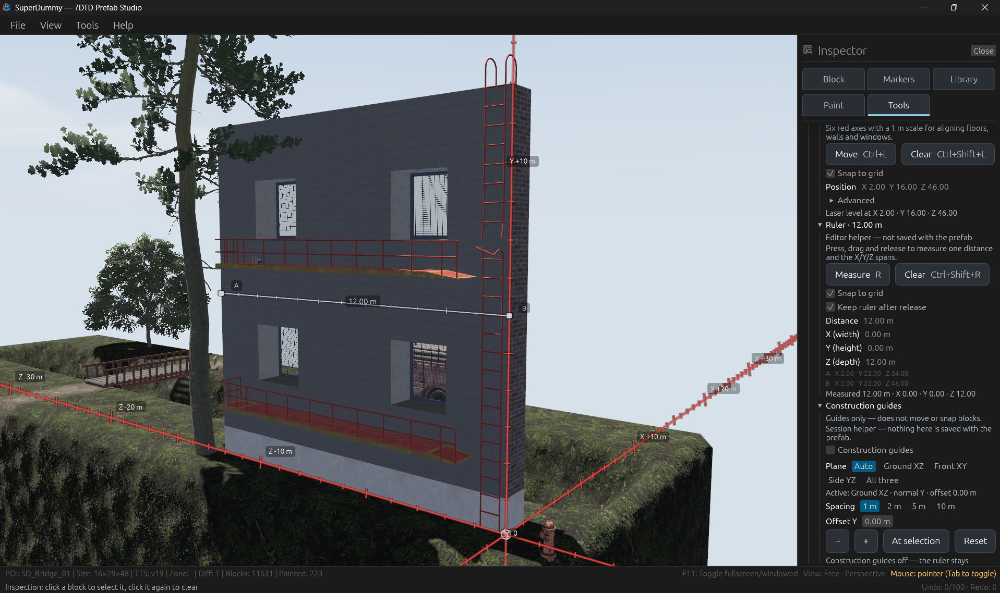

### Paint and picture mosaics

The **Paint** tab contains the six tools. A picture stays loaded for the session, so you can place it again without reopening the file. The preview shows how the limited game-paint palette will represent it; more blocks give more detail.

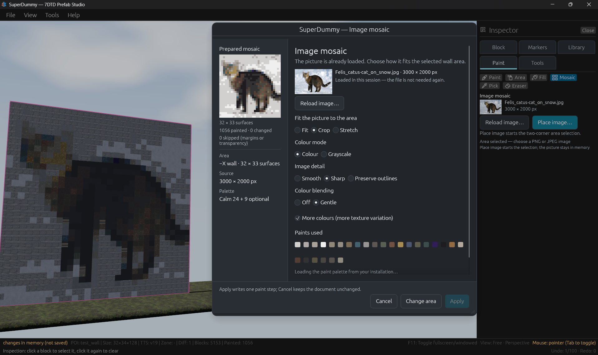

## A closer look at 0.2

### Start with a simple workspace

Choose a name, the starting ground size and whether to add a ground layer. You can grow the working area as you build.

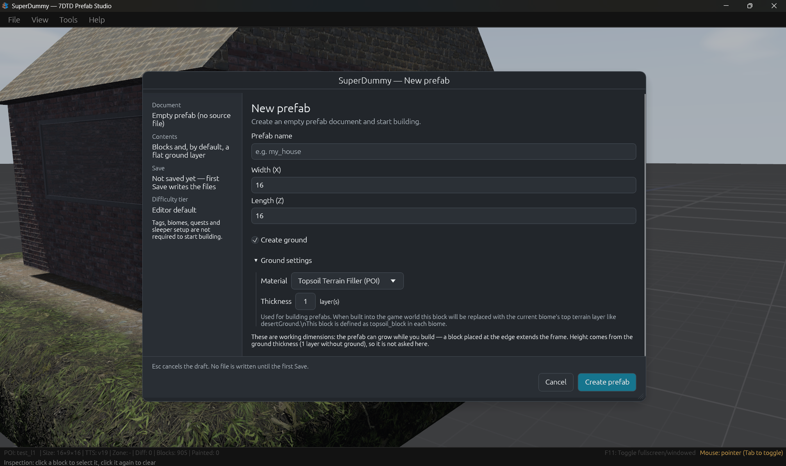

Built-in beginner guide

The English guide explains the controls, saving and how to put your first building into a new game world.

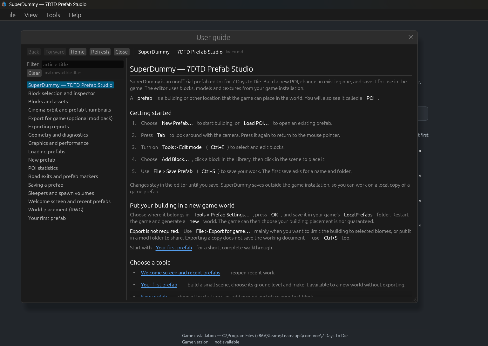

Earlier viewing and presentation screenshots (0.1.0)

*These screenshots are from **0.1.0 — Water Edition**. They show the viewing and presentation tools, not the new 0.2 editing interface.*

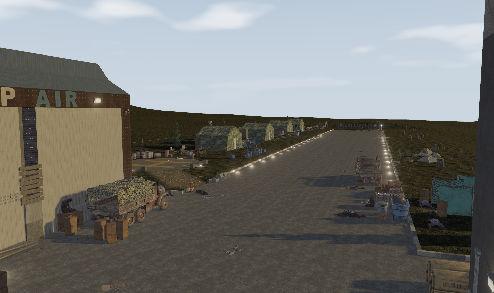

<table>
  <tr>
    <td>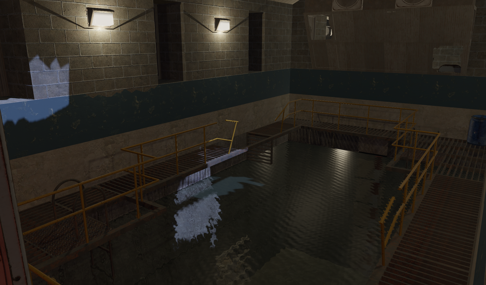</td>
    <td>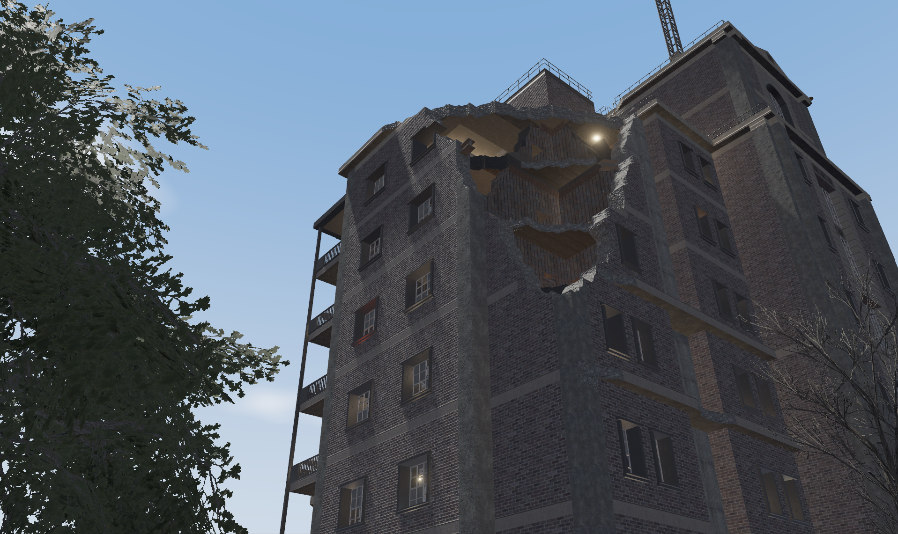</td>
  </tr>
  <tr>
    <td>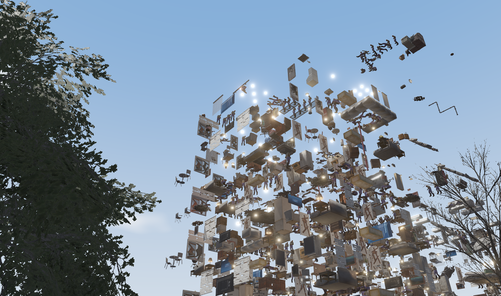</td>
    <td>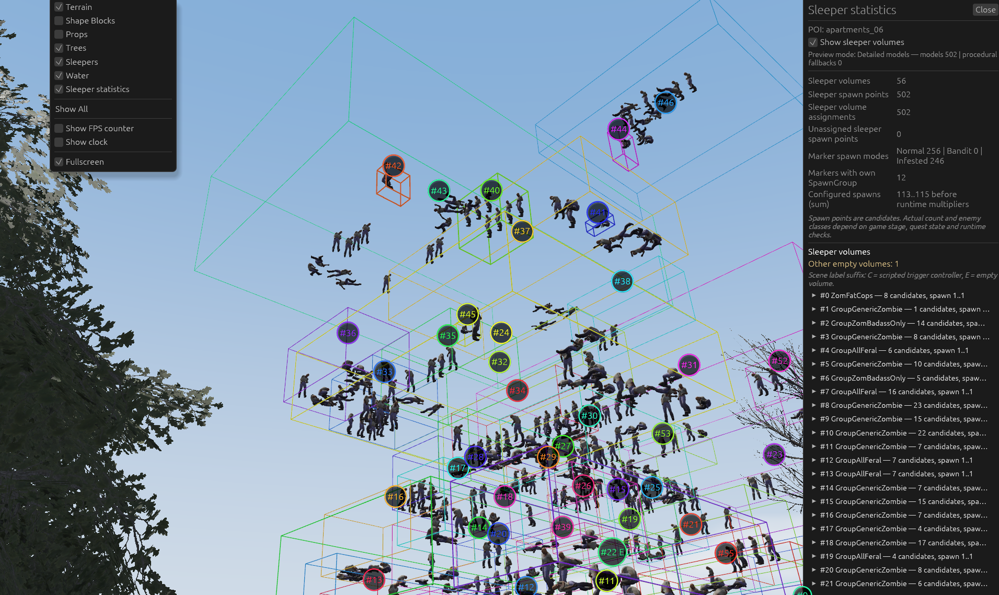</td>
  </tr>
</table>

*More views rendered by SuperDummy 0.1.0, including a blocks-hidden view and the sleeper statistics panel.*

## What you need

- **Windows 10/11, 64-bit**, with a Vulkan-capable GPU and current drivers.
- **8 GB RAM minimum; 16 GB recommended.**
- Your own, compatible installation of **7 Days to Die**. Game files and assets are not included.

**Game-data baseline: 7 Days to Die 3.3.0 (b18).** Earlier game checks covered sample POIs with corrected ground level and road connections. The new 0.2.3 tools were checked in the editor as development progressed.

Other limits worth knowing

- Mod-added block definitions and assets are not loaded; local prefabs use the base game's blocks and assets.
- The structural preview estimates support. Collapse, AI, electrical networks and actual enemy spawns are simulated by the game.
- Powered-device editing and the elevator test door profile are outside the non-powered door workflow.
- Some separate canvas-sign libraries have explicit save restrictions. Export does not generate distant `.mesh` / `.ins` files.
- Modded world-placement rule order is not fully analysed; reported Forest/Snow placement is not exhaustive proof of exclusion from other biomes.
- Water is a **visual approximation**, not a fluid simulation.
- **Scenic Terrain** is a presentation background, not an exportable game world.
- **Cinema orbit** controls the camera only; recording a video requires an external screen recorder.
- Thumbnails are **280 × 210 JPEG** images and are available for **local prefabs** only.
- Higher lamp shadow limits and tilt-shift can reduce the frame rate. The depth prepass option is experimental and requires a restart.

## Need a hand?

Start with **Help > User guide** in the program. To report a problem or suggest an improvement, use **[GitHub Issues](https://github.com/xvgray/superdummy-releases/issues)**.

Tell us which **SuperDummy version**, **game version** and **prefab** you were using, what you tried, and what happened. A screenshot helps. For crashes or display problems, include your Windows version, graphics card and the relevant part of `%LOCALAPPDATA%\SuperDummy\logs\lastrun.log`.

Please do not upload game assets. This is a hobby project still under active development; reports from different PCs and prefabs help improve it.

You can also find the project on **[Nexus Mods](https://www.nexusmods.com/7daystodie/mods/12367)**. Use the download button at the top of this page for the current GitHub release.

The application source is kept in a separate private repository. This public page is for downloads, documentation and feedback.

## What I'm working toward

I'm continuing to develop SuperDummy toward the tools available in the game's own prefab editor — and additional features beyond them. Making building clearer, faster and more comfortable is just as important as adding missing features. Work continues on new tools, bug fixes and a friendlier everyday workflow; these are development goals, not features already available in 0.2.

See the [roadmap](ROADMAP.md) for released features and the next planned steps.

## Support the project

If SuperDummy helps with your builds, a ⭐ on this repository or a shared screenshot is a welcome way to support it. You can also support development here:

Every contribution helps with development, testing and future features. Thank you!

## License — Freeware

SuperDummy is distributed as freeware for personal or commercial use, subject to the license terms. See the full **[SuperDummy Freeware License](LICENSE.md)**.

## Disclaimer

SuperDummy is an independent, unofficial fan-made tool. It is not affiliated with, endorsed by or supported by The Fun Pimps or the developers and publishers of 7 Days to Die. 7 Days to Die and related names, trademarks and game assets belong to their respective owners. SuperDummy does not distribute game assets and requires users to provide their own compatible installation.

---

Made with [Rust](https://rust-lang.org/) and [Bevy](https://bevy.org/)

