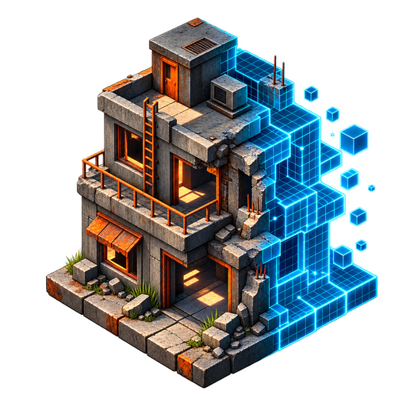
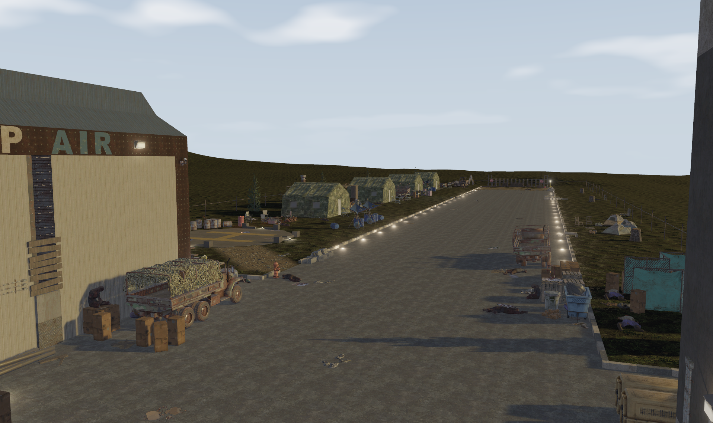
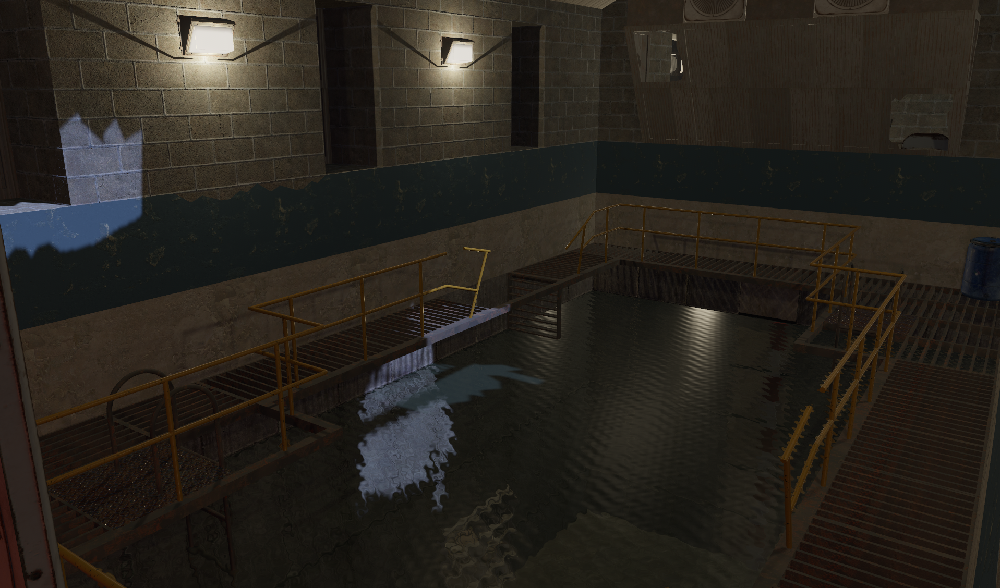
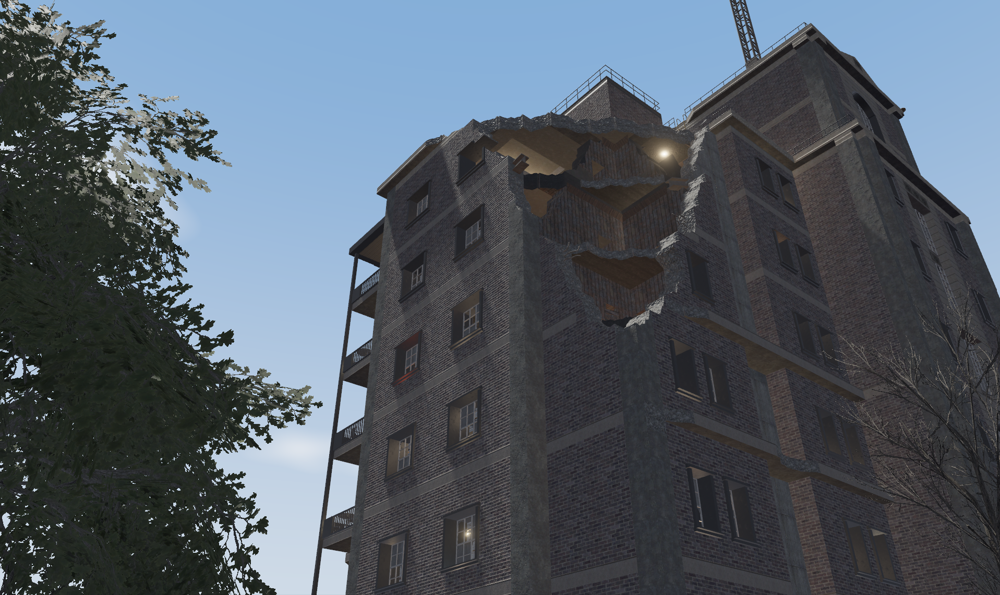
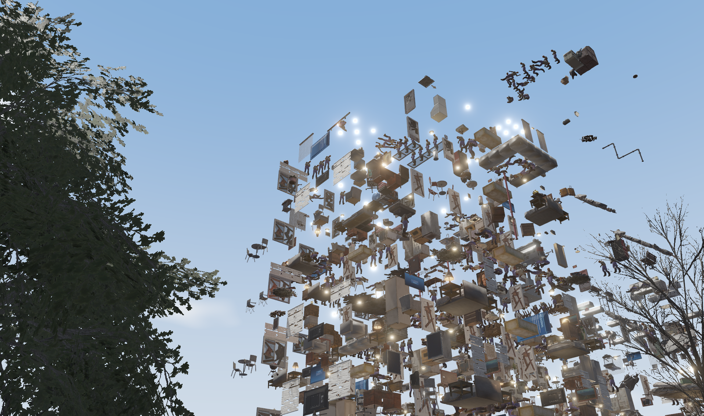
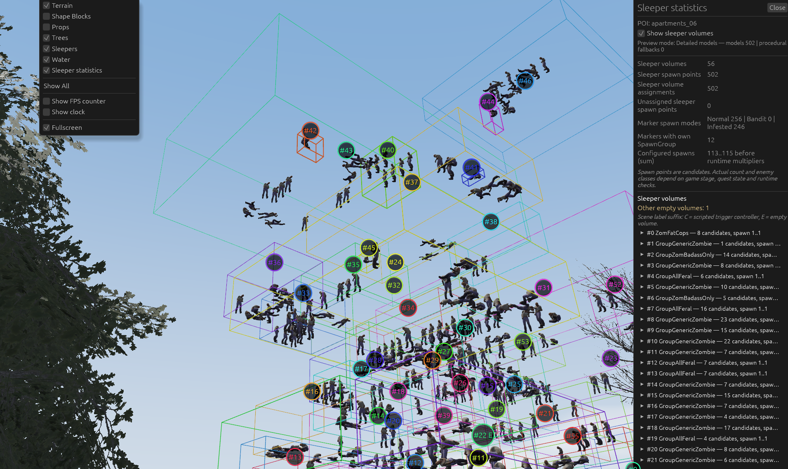

# SuperDummy

**0.2.0 — Forge Edition**

*From viewing to creating.*

**Build, explore and edit your own locations for 7 Days to Die.**

A prefab, also called a POI, is a building or place the game can put in its world. SuperDummy lets you work on one without opening a game world — no coding or Unity installation needed.

[Release notes](https://github.com/xvgray/superdummy-releases/releases/tag/v0.2.0) · [First steps](#start-in-a-few-minutes) · [What can I make?](#what-you-can-do) · [Report an issue](https://github.com/xvgray/superdummy-releases/issues) · [Support development](https://buymeacoffee.com/bullrider)

**Windows 10/11, 64-bit · Requires your own 7 Days to Die installation · No game assets included**

> [!IMPORTANT]
> **Please save your work often.** This version is still in development and may contain bugs. There is **no emergency autosave or recovery after a crash**. Unsaved work can be lost if the program closes unexpectedly. Use **Ctrl+S** regularly and **Save Prefab As…** to keep separate copies before major changes.
>
> **Water can be previewed, but cannot be edited in 0.2.** Automatic saving, crash recovery and tools for editing whole regions are not included in this release.

## What you can do

- **Start a new building** with an empty workspace or flat ground, or open an existing prefab as a local copy.
- **Build and change individual objects** — place, move, copy, turn and remove them, with a preview and Undo/Redo.
- **Find your favourite parts quickly** in the block Library, choose variants and pin frequently used blocks to Quick Blocks.
- **Set up supported doors and lights** — choose Open/Closed, Locked/Unlocked or On/Off, and edit supported writable signs.
- **Prepare your POI for the game** — choose its world locations, set the ground level, add road-connection markers and edit the supplied basic enemy-spawn areas.
- **Explore and show your work** — fly around, inspect interiors, read statistics, save thumbnails and use the cinematic orbit camera.

SuperDummy reads blocks, models and textures from your own game installation. It does not modify the installed game files or include game assets in its download.

## Current editing limits

- **No block-painting tools yet.** Existing paint can be shown and kept by supported edits, but you cannot paint or repaint blocks in this version.
- **Mod-added blocks are not loaded.** SuperDummy reads the base game's block definitions and assets, not blocks or assets supplied by mods. A prefab that needs them may have missing parts.
- **Some game mechanisms are not supported yet**, including gas valves. Seeing an object's model does not mean its special behaviour can be configured or tried out in the editor.
- **Very large prefabs may have problems loading or being edited.** They can take a long time to open, use a lot of memory or become slow to work with. Save often and keep separate copies of important projects.

Water editing and emergency autosave/crash recovery are also unavailable, as noted above. Version 0.2 may still contain bugs; please keep that in mind when working on a large or important build.

## Start in a few minutes

1. Download **[SuperDummy 0.2.0 for Windows x64](https://github.com/xvgray/superdummy-releases/releases/download/v0.2.0/SuperDummy-0.2.0-forge-edition-windows-x64.zip)** and extract the **entire ZIP**.
2. Keep the **assets** and **resources** folders beside **superdummy.exe**. There is no installer, and you do not need to install Rust or Bevy.
3. Run `superdummy.exe`. SuperDummy tries to find your game installation; select the game folder if prompted.
4. Choose **New Prefab…** to start building, or **Load POI…** to open an existing prefab.
5. Open **Help > User guide > Your first prefab** for a complete beginner walkthrough. **Tab** switches between the pointer and camera control; **Ctrl+S** saves your work.

The default local prefab folder is `%APPDATA%\7DaysToDie\LocalPrefabs`; you can choose another folder in the browser. Settings, logs and caches are stored in `%LOCALAPPDATA%\SuperDummy` (preferences in `settings.xml`).

> **Download the named Windows ZIP, not GitHub's automatic “Source code” archives.** This repository contains public release documentation, not the application source.

When updating, unpack the new version into a separate folder so old program files are not mixed with the new ones. Your saved local prefabs and application preferences stay in their own folders.

### A few useful controls

| What you want | What to do |
| --- | --- |
| Look around or return to the pointer | Press **Tab**. |
| Move the camera | In camera control, use **WASD**; **Space** goes up and **Alt** goes down. |
| Choose something to build with | Click **Add Block…**. |
| Turn the block you are holding | Use the **mouse wheel** while pointing at the scene. |
| Cancel a placement | Press **Esc**. |
| Undo an edit | Press **Ctrl+Z** in Edit mode. |
| Save your work | Press **Ctrl+S**. |

## Try your building in the game

1. Open **Tools > Prefab Settings…**, choose a suitable location and press **OK**. For a first isolated house, **Outside settlements** is a simple choice.
2. Press **Ctrl+S** and save in the game's **LocalPrefabs** folder, normally `%APPDATA%\7DaysToDie\LocalPrefabs`. Keep the `.tts`, `.blocks.nim` and `.xml` together.
3. Restart the game and generate a **new** world. The generator can consider your building when a suitable place is available. Placement is not guaranteed, and existing worlds are not rebuilt.

**You do not need to export or create a mod for this.** A saved local prefab with suitable location choices is enough to make it available.

### When should I use Export for game?

Use **File > Export for game…** mainly to limit the building to selected biomes, such as Forest and Snow, or to prepare a mod folder to share. The export screen explains how to install the resulting pack.

A **location** describes a kind of place, such as Outside settlements or Residential district. A **biome** describes the landscape, such as Forest or Snow. Biome choices alone do not make a building available. **Export includes a copy of your edits but does not save the working document — use Ctrl+S too.**

Check **View > Ground Level** before a game trial. Use **Tools > Set Ground Level…** if the building meets the world terrain at the wrong height. Road-exit markers can request a wilderness approach; several markers give the generator a choice, not a promise of several roads.

## What's new in 0.2.0 — Forge Edition

**From viewing to creating.** Create and edit prefabs, use the block Library and Quick Blocks, adjust supported doors and lights, configure basic sleeper areas, choose world locations and create road connections. Save your work locally and check it in the game.

This release also adds optional biome-aware mod-pack export, clearer installation instructions and a beginner's **Your first prefab** guide. It fixes affected window frame/glass materials, supported door geometry, saved-frame bounds and the half-block offset of chain-link rail previews.

[Read the full 0.2.0 release notes](https://github.com/xvgray/superdummy-releases/releases/tag/v0.2.0) · [Changelog](CHANGELOG.md)

## See the preview

*These screenshots are from **0.1.0 — Water Edition**. They show the viewing and presentation tools, not the new 0.2 editing interface.*

More screenshots

<table>
  <tr>
    <td></td>
    <td></td>
  </tr>
  <tr>
    <td></td>
    <td></td>
  </tr>
</table>

*More views rendered by SuperDummy 0.1.0, including a blocks-hidden view and the sleeper statistics panel.*

## What you need

- **Windows 10/11, 64-bit**, with a Vulkan-capable GPU and current drivers.
- **8 GB RAM minimum; 16 GB recommended.**
- Your own, compatible installation of **7 Days to Die**. Game files and assets are not included.

**Development baseline and reported game checks: 7 Days to Die V 3.3.0 (b18).** The user checked the reported editing cases and generated POIs with corrected ground level and road connections. This is not exhaustive verification of every model, mod or placement rule. Detecting an installation alone does not prove compatibility.

Other limits worth knowing

- Mod-added block definitions and assets are not loaded; local prefabs use the base game's blocks and assets.
- SuperDummy does not simulate AI, structural collapse, electrical networks or actual spawn behaviour. Sleeper previews do not predict the exact enemies spawned.
- Powered-device editing and the elevator test door profile are outside the non-powered door workflow.
- Some separate canvas-sign libraries have explicit save restrictions. Export does not generate distant `.mesh` / `.ins` files.
- Modded world-placement rule order is not fully analysed; reported Forest/Snow placement is not exhaustive proof of exclusion from other biomes.
- Water is a **visual approximation**, not a fluid simulation.
- **Scenic Terrain** is a presentation background, not an exportable game world.
- **Cinema orbit** controls the camera only; recording a video requires an external screen recorder.
- Thumbnails are **280 × 210 JPEG** images and are available for **local prefabs** only.
- Higher lamp shadow limits and tilt-shift can reduce the frame rate. The depth prepass option is experimental and requires a restart.

## Need a hand?

Start with **Help > User guide** in the program. To report a problem or suggest an improvement, use **[GitHub Issues](https://github.com/xvgray/superdummy-releases/issues)**.

Tell us which **SuperDummy version**, **game version** and **prefab** you were using, what you tried, and what happened. A screenshot helps. For crashes or display problems, include your Windows version, graphics card and the relevant part of `%LOCALAPPDATA%\SuperDummy\logs\lastrun.log`.

Please do not upload game assets. This is a hobby project still under active development; reports from different PCs and prefabs help improve it.

You can also find the project on **[Nexus Mods](https://www.nexusmods.com/7daystodie/mods/12367)**. Use the download button at the top of this page for the current GitHub release.

The application source is kept in a separate private repository. This public page is for downloads, documentation and feedback.

## What I'm working toward

I'm continuing to develop SuperDummy toward the tools available in the game's own prefab editor — and additional features beyond them. Making building clearer, faster and more comfortable is just as important as adding missing features. Work continues on new tools, bug fixes and a friendlier everyday workflow; these are development goals, not features already available in 0.2.

## Support the project

If SuperDummy helps with your builds, a ⭐ on this repository or a shared screenshot is a welcome way to support it. You can also support development here:

Every contribution helps with development, testing and future features. Thank you!

## License — Freeware

SuperDummy is distributed as freeware for personal or commercial use, subject to the license terms. See the full **[SuperDummy Freeware License](LICENSE.md)**.

## Disclaimer

SuperDummy is an independent, unofficial fan-made tool. It is not affiliated with, endorsed by or supported by The Fun Pimps or the developers and publishers of 7 Days to Die. 7 Days to Die and related names, trademarks and game assets belong to their respective owners. SuperDummy does not distribute game assets and requires users to provide their own compatible installation.

---

Made with [Rust](https://rust-lang.org/) and [Bevy](https://bevy.org/)

