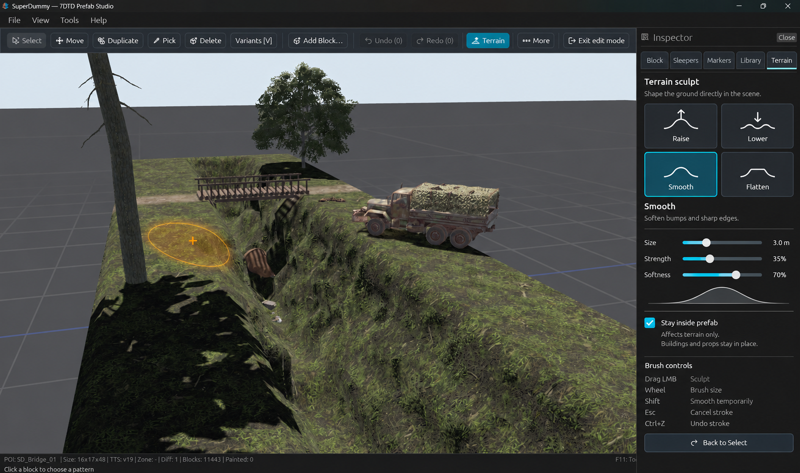

# SuperDummy roadmap

Updated **27 October 2026**. Latest release:
**[0.2.0 — Forge Edition](https://github.com/xvgray/superdummy-releases/releases/tag/v0.2.0)**.

The aim is to bring the tools available in the game's prefab editor to
SuperDummy, then add tools that make building easier and faster. Work continues
step by step on missing features, bug fixes and comfort of use.

**This is a direction, not a release calendar.** Future version numbers are
targets; order and scope may change. A checked item means the stated feature
is included in the release, not that every model, game version or mod has been
verified.

## Released in 0.2.0 — Forge Edition

**From viewing to creating.**

- [x] New prefabs, empty or flat starting ground and ground-level editing.
- [x] Individual-object selection, placement, Move, Duplicate, Pick, Delete,
      rotation, variants, previews and Undo/Redo.
- [x] Save/Save As, saved-state feedback and prompts for unsaved work.
- [x] Welcome/recent prefabs, Studio dialogs and improved camera controls.
- [x] Block Library, Quick Blocks and separate Player/developer visibility.
- [x] Supported non-powered doors, shutters, hatches, gates and drawbridges:
      endpoint previews, Open/Closed and independent Lock editing.
- [x] Supported lamp state and writable sign/crate text editing.
- [x] Basic sleeper-point, spawn-volume and group tools, with warnings and
      existing statistics.
- [x] Difficulty settings and an explained, limited difficulty estimate.
- [x] World locations and Advanced Tags editing in Prefab Settings.
- [x] Road-exit creation, editing, duplication, Move/Resize, edge snapping and
      connection-center/width helpers.
- [x] Working/saved-size feedback and corrected empty-margin handling.
- [x] Optional mod-pack export, selected-biome rules, reusable export settings
      and installation guidance.
- [x] Existing thumbnail capture/preservation, statistics and presentation tools.
- [x] Updated beginner help, first-prefab walkthrough and known-limit notes.

Development checks used **7 Days to Die V 3.3.0 (b18)**. These covered generated
POI examples with corrected ground level and road approaches, and a selection
of editing/rendering cases. This is not exhaustive verification of all
features, game mechanisms or biome-rule combinations.

**Export is optional.** Save a prefab with suitable location choices into
LocalPrefabs to make it available for a new world's generation. Export mainly
helps restrict biomes or prepare a mod folder to share; it does not save the
working document. The game still decides whether a building is placed.

## What 0.2 does not include

- Painting or repainting blocks. Existing paint can be shown and preserved by
  supported edits, but there are no painting tools yet.
- Editing water. The water preview is not a water-editing tool or fluid simulation.
- Emergency autosave or crash recovery. **Use Ctrl+S often and keep separate
  copies of important work.** Bugs may still occur.
- Loading block definitions and assets added by mods.
- Full support for all game mechanisms, including gas valves and powered devices.
- Moving/copying whole rooms, floors or other selected regions as one operation.

Very large prefabs may have loading or editing problems, long waits, high memory
use or low frame rates. Performance and reliability remain ongoing work.

## Next patch — 0.2.1: scope closed

**Scope closed; final work in progress. Not released.**
The public download remains 0.2.0. The agreed fixes have been checked during
development; configurable Undo limits are the last implementation still in
progress. The [0.2.1 checklist](PATCH_0.2.1.md) separates completed fixes from
remaining work and release preparation.

Completed in development builds:
- A clear missing-location-tag reminder before saving.
- Road-exit and sleeper-volume helpers disappear when their layers are hidden.
- Easier block attachment, thin/rotated-shape picking and open-door targeting.
- A clear amber rotation guide showing wheel direction and the actual axis.
- Consistent Esc cancellation back to Select; right-click opens context menus.
- Independent road-exit and sleeper-volume editing, clearer handles and panels,
  plus right-click → Edit on their outlines and labels.
- A prefab-height compatibility profile and an Inspector that stays hidden on
  the Welcome screen without an open document.
- Corrected blank library previews and clearer optional development support.

The agreed final additions are configurable Undo steps/memory limits and a
separate Undo/Redo group above the Inspector. Undo limits are **in progress**;
the control relocation is **implemented, awaiting a successful combined build
and visual check**. No further feature work is being added to this patch.

These checks cover the reported editing cases. They do not claim exhaustive
compatibility with every model or completed height-boundary trials in the game.
Publication follows the final history/save checks, build and package review.

### Recovery remains planned

The earlier plan assigned recovery to 0.2.1. The immediate 0.2.1 scope is now
the focused patch above. Versioned session recovery, background recovery
saving with an explicit restore choice, and bounded storage/memory costs
remain planned for a later reliability update, **without an assigned version**.
They are not included in 0.2.0 or promised as part of this patch.

## Later release targets

| Target | What it should help you do |
| --- | --- |
| **0.3 — work with regions** | Select a room, wall or floor; move, copy, delete and rotate supported groups with one Undo. Add isolation/height sections for interiors. Introduce basic single-cell Add/Remove water. |
| **0.4 — build and finish faster** | Build lines, walls and shells; repeat objects; replace compatible block families; paint faces and surfaces. Add a researched structural-support analysis. |
| **0.5 — reuse parts and shape the surroundings** | Reuse your own building fragments, copy between documents, use decoration/terrain tools and starting-terrain templates. Add bounded Fill basin after basic water editing is accepted. |
| **0.6 — more gameplay authoring** | Extend the existing sleeper, object-state and metadata tools with more areas, triggers and clearly shown connections between objects. Investigate additional game mechanisms individually. |
| **0.7 — check and hand off to the game** | Build on the export already available in 0.2: clearer problem reports, work on far-distance/derived files, easier game checks and a separate test-world workflow. |
| **0.8 — optional building assistance** | Allow a chosen local or remote agent to inspect and propose bounded edits, with a preview, approval and Undo. The manual editor remains usable without an agent or paid model. |
| **1.0 — a dependable workshop** | A clear supported scope, reliable workflows, comfortable controls, documentation and explicit compatibility limits. |

These are planned packages, not promises that every idea will ship together.
Features delivered early, such as signs, doors, road exits and basic export,
are already listed under 0.2 rather than being advertised as future work.

### Terrain sculpt — an early design for a later release

**Design mockup — this tool is not implemented or included in 0.2.1.**
The proposed Terrain tab keeps the existing Inspector and adds Raise, Lower,
Smooth and Flatten brushes, with size, strength and a soft edge. The brush
would shape the ground directly in the scene, with one Undo per stroke.

The aim is to make slopes, paths and valleys easier to build. It must work
within the game's terrain resolution and preserve saved terrain data, rather
than only changing how the preview looks. Terrain sculpt remains a **0.5
target**, with no release date; the design and scope can change.

## Other follow-ups — no fixed release number

- Mod-added block/asset support, with a clear distinction between base-game and
  modded configurations.
- Loot-container references/highlighting, additional statistics and POI filters.
- Any loot-potential estimate only after a data-based model exists; it must not
  promise actual rewards or runtime enemy counts.
- Broader performance work based on measurements, especially for large prefabs.
- Further special mechanisms, including gas valves and powered devices, after
  their data and game behaviour have been researched.
- GLB/Blender export as a longer-term possibility.

## Checks still open

Publication does not turn unchecked cases into passed checks. The earlier
roadmap's dedicated waterfall-visibility example still needs its own recheck.
Large-prefab responsiveness and less common failure/input paths also need
continued investigation. Reported bugs will be tracked with concrete examples,
not hidden by a general “all compatible” claim.

Use the **[roadmap discussion](https://github.com/xvgray/superdummy-releases/issues/2)**
for priorities and ideas, or **[report a bug](https://github.com/xvgray/superdummy-releases/issues/new/choose)**
with the app/game versions and the affected prefab.

[Back to the project](README.md) · [Latest release](https://github.com/xvgray/superdummy-releases/releases/latest)
